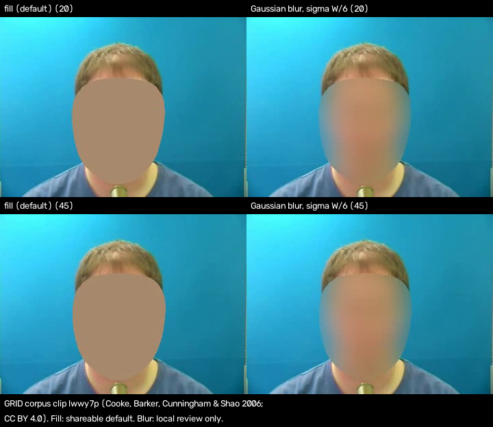

# Face de-identification: motion vs identity

How much face motion each method keeps (useful for semiology review) against how much identity it keeps
(risk). Licences: [FACE_SWAP_LICENCES.md](FACE_SWAP_LICENCES.md).

## Methods

- `fill`: grown landmark hull painted one flat colour, plus a YuNet box fallback; **the shareable default**.
- `mosaic8`: about 8 blocks across the face; **reduced risk, not de-identified**.
- `mosaic16`: about 16 blocks across the face; **not de-identifying**.
- `gauss`: Gaussian blur, sigma = face width / 6; **local review only**.
- `warp`: landmark-driven warp of a synthetic donor; **reduced risk, not de-identified**.
- `ghost` (GHOST face swap): **reduced risk, not de-identified**; research use only, local.
- `liveportrait`: donor animated by the subject's motion; **reduced risk, not de-identified**; research use only, local.

## Fill fallback and unmasked-face check

The Face Landmarker misses some faces (small, turned away). For each frame, `fill` also paints every YuNet
detection that no landmark mask covers, as a box padded 20 % per side. After fill, YuNet runs on every output
frame; if it finds a face (score >= 0.6), the export is marked not shareable and the frame indices are listed
in the sidecar (`UnmaskedFaceCheck`) and printed. A flagged frame first gets its flagged YuNet boxes filled
(even inside a landmark hull) and is checked once more; only frames still flagged block sharing. The written
video is then decoded and checked again with the same settings (`EncodedOutputCheck`). Frames flagged there
get the flagged boxes filled with a wider margin (30 %, then 50 %), the video is written again and the whole
file checked again, up to two passes (`EncodedRefill`); a face still found in the final file blocks sharing. Without the YuNet model, fill runs on landmarks only and the
export can't be marked shareable (`python scripts/fetch_models.py --face-check`).

## Results

hit = share of frames where MediaPipe / YuNet find a face in the output. SFace / ArcFace = share of face
pairs (original vs output, same place) at or above the same-identity threshold (SFace 0.363; ArcFace
`glintr100` 0.30 / 0.45); n = pairs. Landmark r = mean Pearson r of five face-region speeds; blendshape r =
median r over 51 blendshapes (shown when over 50 frames have a face in both). ms/frame = render only, box CPU
(8 vCPU Xeon VM), landmarks excluded. Donors: mesh = procedural mesh render; SFHQ = one synthetic photo
(SFHQ part 3, image 00001482; no SFHQ images are in this repository). Clips: GRID s14 (4 clips, 300 frames),
Intel sample videos (2 clips, 2810 frames).

| Method | Donor | Clips (frames) | MediaPipe / YuNet hit | SFace >= 0.363 (n) | ArcFace >= 0.30 / >= 0.45 (n) | Landmark r / blendshape r | ms/frame | Label |
|---|---|---|---|---|---|---|---|---|
| fill | - | GRID 4/4 (300) | 0 % / 0 % | no face | no face | (0 frames) | 1.1 | shareable fallback (default) |
| mosaic, 8 blocks | - | GRID 4/4 (300) | 11 % / 50 % | 0 % (151) | 0 % / 0 % (151) | (38 frames) | 1.1 | reduced risk, not de-identified |
| mosaic, 16 blocks | - | GRID 4/4 (300) | 100 % / 100 % | 99 % (300) | 100 % / 100 % (300) | 0.25 / 0.32 | 1.1 | not de-identifying |
| Gaussian blur | - | GRID 4/4 (300) | 1.3 % / 0 % | no face | no face | (4 frames) | 8.1 | local review only |
| warp | mesh | GRID 4/4 (300) | 100 % / 100 % | 8.7 % (300) | 0 % / 0 % (300) | 0.78 / 0.68 | 11 | reduced risk, not de-identified |
| warp | SFHQ | GRID 4/4 (300) | 100 % / 100 % | 100 % (300) | 41 % / 0 % (300) | 0.69 / 0.54 | 11 | reduced risk, not de-identified |
| GHOST | mesh | GRID 4/4 (300) | 100 % / 100 % | 43 % (300) | 0 % / 0 % (300) | 0.78 / 0.68 | 384 | reduced risk, not de-identified; research use only, local |
| GHOST | SFHQ | GRID 4/4 (300) | 100 % / 100 % | 64 % (300) | 4.0 % / 0 % (300) | 0.82 / 0.74 | 373 | reduced risk, not de-identified; research use only, local |
| LivePortrait | mesh | GRID 4/4 (300) | 100 % / 100 % | 1.7 % (300) | 0 % / 0 % (300) | 0.14 / 0.02 | 1951 | reduced risk, not de-identified; research use only, local |
| LivePortrait | SFHQ | GRID 4/4 (300) | 100 % / 100 % | 39 % (300) | 0 % / 0 % (300) | 0.60 / 0.39 | 1887 | reduced risk, not de-identified; research use only, local |
| fill | - | Intel 2/2 (2810) | 0.2 % / 0.7 % | 79 % (19) | 79 % / 79 % (19) | (19 frames) | 1.1 | shareable fallback (default) |
| mosaic, 8 blocks | - | Intel 2/2 (2810) | 13 % / 51 % | 5.4 % (1764) | 2.0 % / 0.9 % (1764) | 0.16 / 0.01 | 1.1 | reduced risk, not de-identified |
| mosaic, 16 blocks | - | Intel 2/2 (2810) | 68 % / 73 % | 89 % (3849) | 92 % / 86 % (3849) | 0.25 / 0.09 | 1.1 | not de-identifying |
| Gaussian blur | - | Intel 2/2 (2810) | 0.5 % / 4.2 % | 12 % (124) | 11 % / 11 % (124) | (16 frames) | 8.1 | local review only |
| warp | mesh | Intel 2/2 (2810) | 73 % / 73 % | 5.7 % (3866) | 0.8 % / 0.4 % (3866) | 0.50 / 0.29 | 11 | reduced risk, not de-identified |
| warp | SFHQ | Intel 2/2 (2810) | 73 % / 73 % | 26 % (3917) | 1.0 % / 0.4 % (3917) | 0.47 / 0.27 | 11 | reduced risk, not de-identified |
| GHOST | mesh | Intel 2/2 (2810) | 73 % / 73 % | 31 % (3920) | 1.0 % / 0.4 % (3920) | 0.55 / 0.41 | 384 | reduced risk, not de-identified; research use only, local |
| GHOST | SFHQ | Intel 2/2 (2810) | 73 % / 73 % | 17 % (3928) | 1.2 % / 0.5 % (3928) | 0.53 / 0.44 | 373 | reduced risk, not de-identified; research use only, local |
| LivePortrait | mesh | Intel 2/2 (2810) | 71 % / 70 % | 2.2 % (3624) | 0.5 % / 0.4 % (3624) | 0.18 / -0.01 | 1951 | reduced risk, not de-identified; research use only, local |
| LivePortrait | SFHQ | Intel 2/2 (2810) | 68 % / 72 % | 2.3 % (3800) | 0.4 % / 0.4 % (3800) | 0.32 / 0.20 | 1887 | reduced risk, not de-identified; research use only, local |

The Intel `fill` row is before the fallback: YuNet found a face in 19 output frames (5 + 14). With the fallback
(15 boxes) it finds 4 (0 + 4); the second pass fills those 4 and the recheck finds none, so both Intel clips and
all 4 GRID clips pass. Fill with fallback and check: 13-15 ms/frame (Intel), 6 ms/frame (GRID), box CPU.

### Mosaic and blur per clip

A clip is an identity match when it has at least 20 face pairs and at least 50 % are at or above SFace 0.363
or ArcFace 0.30. `mosaic16` matched on 6 of 6 clips.

| Clip | Method | YuNet hit | SFace >= 0.363 (n) | ArcFace >= 0.30 / >= 0.45 (n) | Identity match |
|---|---|---|---|---|---|
| Clip | Method | YuNet hit | SFace >= 0.363 (n) | ArcFace >= 0.30 / >= 0.45 (n) | Identity match |
|---|---|---|---|---|---|
| GRID lwwy7p | mosaic8 | 47 % | 0 % (35) | 0 % / 0 % (35) | no |
| GRID lwwy7p | mosaic16 | 100 % | 100 % (75) | 100 % / 99 % (75) | yes |
| GRID lwwy7p | gauss | 0 % | no face | no face | - |
| GRID bbad9n | mosaic8 | 65 % | 0 % (49) | 0 % / 0 % (49) | no |
| GRID bbad9n | mosaic16 | 100 % | 100 % (75) | 100 % / 100 % (75) | yes |
| GRID bbad9n | gauss | 0 % | no face | no face | - |
| GRID bbae1p | mosaic8 | 77 % | 0 % (58) | 0 % / 0 % (58) | no |
| GRID bbae1p | mosaic16 | 100 % | 100 % (75) | 100 % / 100 % (75) | yes |
| GRID bbae1p | gauss | 0 % | no face | no face | - |
| GRID bbae2a | mosaic8 | 12 % | 0 % (9) | 0 % / 0 % (9) | too few faces (n < 20) |
| GRID bbae2a | mosaic16 | 100 % | 96 % (75) | 100 % / 100 % (75) | yes |
| GRID bbae2a | gauss | 0 % | no face | no face | - |
| Intel face-demographics-walking-and-pause | mosaic8 | 41 % | 4.6 % (591) | 3.0 % / 1.0 % (591) | no |
| Intel face-demographics-walking-and-pause | mosaic16 | 43 % | 86 % (775) | 87 % / 73 % (775) | yes |
| Intel face-demographics-walking-and-pause | gauss | 0.6 % | 71 % (7) | 71 % / 71 % (7) | too few faces (n < 20) |
| Intel head-pose-face-detection-female-and-male | mosaic8 | 57 % | 5.8 % (1173) | 1.4 % / 0.8 % (1173) | no |
| Intel head-pose-face-detection-female-and-male | mosaic16 | 92 % | 89 % (3074) | 93 % / 90 % (3074) | yes |
| Intel head-pose-face-detection-female-and-male | gauss | 6.5 % | 8.5 % (117) | 7.7 % / 7.7 % (117) | no |

## Figure 1: fill and blur on a GRID frame

Top row frame 20, bottom row frame 45 of GRID clip `lwwy7p` (speaker s14); W = face box width (108 px).
Left: **fill** (shareable default). Right: **Gaussian blur** (sigma W / 6; local review only).

Credit: frames from the GRID audio-visual speech corpus, M. Cooke, J. Barker, S. Cunningham and X. Shao
(2006), <https://doi.org/10.5281/zenodo.3625687>, CC BY 4.0 (<https://creativecommons.org/licenses/by/4.0/>).
Modified (face filled or blurred; panels arranged and captioned). The figure is CC BY 4.0, not MIT.
