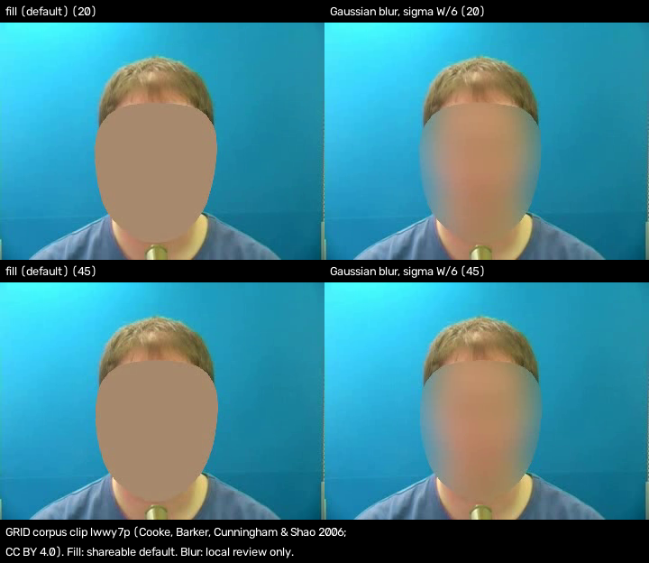

# Face de-identification: do landmarks survive?

When the face tracker (MediaPipe Face Landmarker) runs on the de-identified video itself, how much of the
facial landmark data is still there, and how much identity remains? Short answer: no method keeps the
landmarks fully, warp and GHOST keep them partly to well, and the rest keep little. Interpreting the motion is
for clinical experts. Licences: [FACE_SWAP_LICENCES.md](FACE_SWAP_LICENCES.md).

**Landmarks by default come from the raw video.** The usual path runs the tracker on the original frames and
saves all 478 landmarks and 52 blendshapes next to the clip (`_landmarks.nc`, `_blendshapes.nc`;
[SEGMENT_STORAGE.md](SEGMENT_STORAGE.md)). How the shared video is de-identified, including `fill`, does not
change those saved landmarks, so fill is not part of the comparison below.

## Results

Each cell: GRID / Intel clips. "-" = too few frames with a face to measure.

| Method | Donor | Landmarks preserved | Face still found (%) | Motion match | Expression match | Tracking dropouts per 100 frames | Jitter (% of face width) | Identity still recognizable (%) |
|---|---|---|---|---|---|---|---|---|
| original | - | reference | 100 / 73 | 1 (reference) | 1 (reference) | 0 / 0.71 | 0.15 / 0.22 | - |
| GHOST | SFHQ | good / partial | 100 / 73 | 0.82 / 0.53 | 0.74 / 0.44 | 0 / 0.57 | 0.17 / 0.19 | 64 / 17 |
| GHOST | mesh | good / partial | 100 / 73 | 0.78 / 0.55 | 0.68 / 0.41 | 0 / 0.57 | 0.16 / 0.23 | 43 / 31 |
| warp | mesh | good / partial | 100 / 73 | 0.78 / 0.50 | 0.68 / 0.29 | 0 / 0.57 | 0.18 / 0.25 | 8.7 / 5.7 |
| warp | SFHQ | partial / partial | 100 / 73 | 0.69 / 0.47 | 0.54 / 0.27 | 0 / 0.57 | 0.16 / 0.21 | 100 / 26 |
| LivePortrait | SFHQ | partial / poor | 100 / 68 | 0.60 / 0.32 | 0.39 / 0.20 | 0 / 1.78 | 0.17 / 0.46 | 39 / 2.3 |
| LivePortrait | mesh | poor / poor | 100 / 71 | 0.14 / 0.18 | 0.02 / -0.01 | 0 / 1.07 | 0.25 / 0.47 | 1.7 / 2.2 |
| mosaic, 16 blocks | - | poor / poor | 100 / 68 | 0.25 / 0.25 | 0.32 / 0.09 | 0 / 1.00 | 0.43 / 0.49 | 100 / 92 |
| mosaic, 8 blocks | - | poor / poor | 11 / 13 | - / 0.16 | - / 0.01 | 11.7 / 4.9 | - / 0.97 | 0 / 5.4 |
| Gaussian blur | - | poor / poor | 1.3 / 0.5 | - / - | - / - | 2.7 / 0.78 | - / - | no face / 12 |

- **Landmarks preserved**: good = face found as often as the original, steady, motion match 0.7 or more;
  partial = 0.4 to 0.7; poor = below 0.4 or the face is mostly lost.
- **Face still found**: share of frames where the tracker finds a face in the de-identified video.
- **Motion match** (0 to 1, 1 = same as original): how closely the movement of five face regions (mouth, eyes,
  face sides) follows the original.
- **Expression match** (0 to 1, 1 = same as original): the same for the 51 blendshape expression scores.
- **Tracking dropouts per 100 frames**: how often the face is lost or picked up again; lower is steadier.
- **Jitter** (% of face width, lower is steadier): frame-to-frame shake of the landmarks.
- **Identity still recognizable**: share of frames where face recognition (SFace or ArcFace, whichever is
  higher) still matches the person; lower is better.

In short: GHOST and warp keep the face found as often as the original, with similar jitter, and keep most of
the motion on the clean GRID clips (0.7-0.8) and about half on the harder Intel clips (about 0.5).
LivePortrait keeps the face but jitters about twice as much on the Intel clips, drops out more often and keeps
less motion. Mosaic either breaks tracking (8 blocks) or barely hides identity (16 blocks); blur hides the face
from the tracker. None of these methods is labelled de-identified (see Methods).

Motion match by face region (subject's left / right; GRID / Intel):

| Method | Donor | Mouth | Eyes L / R | Face side L / R |
|---|---|---|---|---|
| GHOST | SFHQ | 0.87 / 0.40 | 0.81, 0.75 / 0.52, 0.59 | 0.84, 0.81 / 0.55, 0.56 |
| GHOST | mesh | 0.86 / 0.51 | 0.73, 0.74 / 0.51, 0.54 | 0.80, 0.79 / 0.60, 0.61 |
| warp | mesh | 0.86 / 0.43 | 0.76, 0.78 / 0.49, 0.53 | 0.75, 0.76 / 0.54, 0.50 |
| warp | SFHQ | 0.74 / 0.46 | 0.57, 0.65 / 0.41, 0.49 | 0.74, 0.77 / 0.50, 0.50 |
| LivePortrait | SFHQ | 0.68 / 0.24 | 0.50, 0.43 / 0.35, 0.38 | 0.71, 0.67 / 0.31, 0.31 |
| LivePortrait | mesh | 0.21 / 0.19 | 0.11, 0.05 / 0.17, 0.16 | 0.17, 0.17 / 0.21, 0.18 |
| mosaic, 16 blocks | - | 0.50 / 0.24 | 0.13, 0.12 / 0.18, 0.19 | 0.23, 0.26 / 0.30, 0.33 |

## Methods

`warp`: landmark-driven warp of a synthetic donor. `ghost`: GHOST face swap. `liveportrait`: donor animated by
the subject's motion. GHOST and LivePortrait are research use only, local. `mosaic8` / `mosaic16`: about 8 / 16
blocks across the face. `gauss`: Gaussian blur, sigma = face width / 6. Labels: warp, GHOST, LivePortrait and
mosaic 8 are reduced risk, not de-identified; mosaic 16 is not de-identifying; blur is local review only.

## Fill (shareable video default)

`fill` paints the grown landmark hull one flat colour, plus YuNet boxes (padded 20 %) for faces the tracker
missed. YuNet then checks every output frame and the written file (score >= 0.6); flagged frames are filled
again with wider boxes, and a face still found in the final file blocks sharing (sidecar: `UnmaskedFaceCheck`,
`EncodedOutputCheck`, `EncodedRefill`; [SEGMENT_STORAGE.md](SEGMENT_STORAGE.md)). Without the YuNet model the
export can't be marked shareable (`python scripts/fetch_models.py --face-check`). With the check, no face was
found in any of the 6 test clips. The filled video has no trackable face by design; its landmarks are the ones
saved from the raw video.

## How measured

- Clips: GRID s14 (4 clips, 300 frames), Intel sample videos (2 clips, 2810 frames). Donors: mesh = procedural
  mesh render; SFHQ = one synthetic photo (SFHQ part 3, image 00001482; no SFHQ images are in this repository).
- Motion and expression match: Pearson r between original and de-identified video, head motion removed,
  frames with a face in both, at least 50 such frames (regions as in [FACE_LANDMARKS.md](FACE_LANDMARKS.md)).
- Dropouts and jitter: `scripts/face_deid_stability.py`, frame by frame, no smoothing. Jitter = median distance
  of each landmark from a centred 5-frame average after removing head motion.
- Identity: share of face pairs (original vs output, same place) at or above SFace 0.363 or ArcFace
  `glintr100` 0.30. A clip counts as an identity match with at least 20 pairs and at least 50 % matching:
  mosaic 16 matched on 6 of 6 clips, mosaic 8 on none.

## Figure 1: fill and blur on a GRID frame

Top row frame 20, bottom row frame 45 of GRID clip `lwwy7p` (speaker s14); W = face box width (108 px).
Left: **fill** (shareable default). Right: **Gaussian blur** (sigma W / 6; local review only).

Credit: frames from the GRID audio-visual speech corpus, M. Cooke, J. Barker, S. Cunningham and X. Shao
(2006), <https://doi.org/10.5281/zenodo.3625687>, CC BY 4.0 (<https://creativecommons.org/licenses/by/4.0/>).
Modified (face filled or blurred; panels arranged and captioned). The figure is CC BY 4.0, not MIT.
