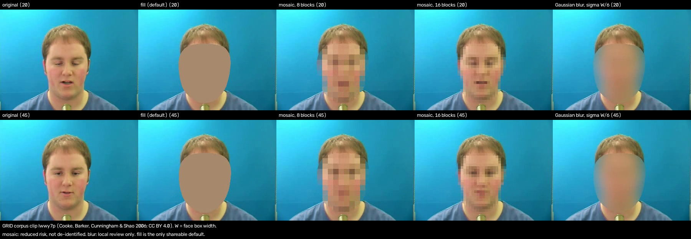

# Face de-identification: motion preservation vs identity (phases 2 to 4)

Generated by `e2e/phase4/tradeoff4.py` (outside this repository) from the measurement results; method and licence details are in [FACE_SWAP_LICENCES.md](FACE_SWAP_LICENCES.md). Generated 2026-10-29 20:21 PDT.

Each method trades how much of the subject's face motion survives (useful for seizure-semiology review) against how much of the subject's identity survives (risk). No method below is treated as de-identified except by removing the face entirely (`fill`).

Columns: hit = share of frames where MediaPipe / YuNet find a face in the output. SFace and ArcFace = share of detected face pairs (original face vs the face YuNet finds at the same place in the output) at or above the same-identity threshold (SFace cosine 0.363; ArcFace `glintr100` cosine 0.30 and 0.45), n = face pairs. Landmark r = mean Pearson r of five face-region speeds, blendshape r = median r over 51 blendshapes, both on frames with a face in original and output (shown only above 50 such frames). ms/frame = render only, box CPU (8 vCPU Xeon VM) otherwise idle, landmarks excluded. Donor: mesh = procedural mesh render (seed 2); SFHQ = synthetic photo, SFHQ part 3 image 00001482.

| Method | Donor | Clips (frames) | MediaPipe / YuNet hit | SFace >= 0.363 (n) | ArcFace >= 0.30 / >= 0.45 (n) | Landmark r / blendshape r | ms/frame | Label | Trade-off |
|---|---|---|---|---|---|---|---|---|---|
| fill | - | GRID 4/4 (300) | 0 % / 0 % | no face | no face | (0 frames) | 1.1 | shareable fallback (default) | motion not measurable (0 frames with a face in both); no face found in the output |
| mosaic, 8 blocks | - | GRID 4/4 (300) | 11 % / 50 % | 0 % (151) | 0 % / 0 % (151) | (38 frames) | 1.1 | reduced risk, not de-identified | motion not measurable (38 frames with a face in both); identity matched in 0 % (SFace) / 0 % (ArcFace 0.30) of detected face pairs |
| mosaic, 16 blocks | - | GRID 4/4 (300) | 100 % / 100 % | 99 % (300) | 100 % / 100 % (300) | 0.25 / 0.32 | 1.1 | not de-identifying | landmark r 0.25, blendshape r 0.32; identity matched in 99 % (SFace) / 100 % (ArcFace 0.30) of detected face pairs |
| Gaussian blur | - | GRID 4/4 (300) | 1.3 % / 0 % | no face | no face | (4 frames) | 8.1 | local review only | motion not measurable (4 frames with a face in both); no face found in the output |
| warp | mesh | GRID 4/4 (300) | 100 % / 100 % | 8.7 % (300) | 0 % / 0 % (300) | 0.78 / 0.68 | 11 | reduced risk, not de-identified | landmark r 0.78, blendshape r 0.68; identity matched in 8.7 % (SFace) / 0 % (ArcFace 0.30) of detected face pairs |
| warp | SFHQ | GRID 4/4 (300) | 100 % / 100 % | 100 % (300) | 41 % / 0 % (300) | 0.69 / 0.54 | 11 | reduced risk, not de-identified | landmark r 0.69, blendshape r 0.54; identity matched in 100 % (SFace) / 41 % (ArcFace 0.30) of detected face pairs |
| GHOST | mesh | GRID 4/4 (300) | 100 % / 100 % | 43 % (300) | 0 % / 0 % (300) | 0.78 / 0.68 | 384 | reduced risk, not de-identified; research use only, local | landmark r 0.78, blendshape r 0.68; identity matched in 43 % (SFace) / 0 % (ArcFace 0.30) of detected face pairs |
| GHOST | SFHQ | GRID 4/4 (300) | 100 % / 100 % | 64 % (300) | 4.0 % / 0 % (300) | 0.82 / 0.74 | 373 | reduced risk, not de-identified; research use only, local | landmark r 0.82, blendshape r 0.74; identity matched in 64 % (SFace) / 4.0 % (ArcFace 0.30) of detected face pairs |
| LivePortrait | mesh | GRID 4/4 (300) | 100 % / 100 % | 1.7 % (300) | 0 % / 0 % (300) | 0.14 / 0.02 | 1951 | reduced risk, not de-identified; research use only, local | landmark r 0.14, blendshape r 0.02; identity matched in 1.7 % (SFace) / 0 % (ArcFace 0.30) of detected face pairs |
| LivePortrait | SFHQ | GRID 4/4 (300) | 100 % / 100 % | 39 % (300) | 0 % / 0 % (300) | 0.60 / 0.39 | 1887 | reduced risk, not de-identified; research use only, local | landmark r 0.60, blendshape r 0.39; identity matched in 39 % (SFace) / 0 % (ArcFace 0.30) of detected face pairs |
| fill | - | Intel 2/2 (2810) | 0.2 % / 0.7 % | 79 % (19) | 79 % / 79 % (19) | (19 frames) | 1.1 | shareable fallback (default) | motion not measurable (19 frames with a face in both); identity matched in 79 % (SFace) / 79 % (ArcFace 0.30) of detected face pairs |
| mosaic, 8 blocks | - | Intel 2/2 (2810) | 13 % / 51 % | 5.4 % (1764) | 2.0 % / 0.9 % (1764) | 0.16 / 0.01 | 1.1 | reduced risk, not de-identified | landmark r 0.16, blendshape r 0.01; identity matched in 5.4 % (SFace) / 2.0 % (ArcFace 0.30) of detected face pairs |
| mosaic, 16 blocks | - | Intel 2/2 (2810) | 68 % / 73 % | 89 % (3849) | 92 % / 86 % (3849) | 0.25 / 0.09 | 1.1 | not de-identifying | landmark r 0.25, blendshape r 0.09; identity matched in 89 % (SFace) / 92 % (ArcFace 0.30) of detected face pairs |
| Gaussian blur | - | Intel 2/2 (2810) | 0.5 % / 4.2 % | 12 % (124) | 11 % / 11 % (124) | (16 frames) | 8.1 | local review only | motion not measurable (16 frames with a face in both); identity matched in 12 % (SFace) / 11 % (ArcFace 0.30) of detected face pairs |
| warp | mesh | Intel 2/2 (2810) | 73 % / 73 % | 5.7 % (3866) | 0.8 % / 0.4 % (3866) | 0.50 / 0.29 | 11 | reduced risk, not de-identified | landmark r 0.50, blendshape r 0.29; identity matched in 5.7 % (SFace) / 0.8 % (ArcFace 0.30) of detected face pairs |
| warp | SFHQ | Intel 2/2 (2810) | 73 % / 73 % | 26 % (3917) | 1.0 % / 0.4 % (3917) | 0.47 / 0.27 | 11 | reduced risk, not de-identified | landmark r 0.47, blendshape r 0.27; identity matched in 26 % (SFace) / 1.0 % (ArcFace 0.30) of detected face pairs |
| GHOST | mesh | Intel 2/2 (2810) | 73 % / 73 % | 31 % (3920) | 1.0 % / 0.4 % (3920) | 0.55 / 0.41 | 384 | reduced risk, not de-identified; research use only, local | landmark r 0.55, blendshape r 0.41; identity matched in 31 % (SFace) / 1.0 % (ArcFace 0.30) of detected face pairs |
| GHOST | SFHQ | Intel 2/2 (2810) | 73 % / 73 % | 17 % (3928) | 1.2 % / 0.5 % (3928) | 0.53 / 0.44 | 373 | reduced risk, not de-identified; research use only, local | landmark r 0.53, blendshape r 0.44; identity matched in 17 % (SFace) / 1.2 % (ArcFace 0.30) of detected face pairs |
| LivePortrait | mesh | Intel 2/2 (2810) | 71 % / 70 % | 2.2 % (3624) | 0.5 % / 0.4 % (3624) | 0.18 / -0.01 | 1951 | reduced risk, not de-identified; research use only, local | landmark r 0.18, blendshape r -0.01; identity matched in 2.2 % (SFace) / 0.5 % (ArcFace 0.30) of detected face pairs |
| LivePortrait | SFHQ | Intel 2/2 (2810) | 68 % / 72 % | 2.3 % (3800) | 0.4 % / 0.4 % (3800) | 0.32 / 0.20 | 1887 | reduced risk, not de-identified; research use only, local | landmark r 0.32, blendshape r 0.20; identity matched in 2.3 % (SFace) / 0.4 % (ArcFace 0.30) of detected face pairs |

### Mosaic and blur per clip

A clip counts as an identity match when it has at least 20 detected face pairs and at least 50 % of them are at or above the SFace 0.363 or the ArcFace 0.30 threshold. `mosaic16` is labelled "not de-identifying" when every clip with enough detected faces is a match; otherwise it keeps "reduced risk, not de-identified".

| Clip | Method | YuNet hit | SFace >= 0.363 (n) | ArcFace >= 0.30 / >= 0.45 (n) | Identity match |
|---|---|---|---|---|---|
| GRID lwwy7p | mosaic8 | 47 % | 0 % (35) | 0 % / 0 % (35) | no |
| GRID lwwy7p | mosaic16 | 100 % | 100 % (75) | 100 % / 99 % (75) | yes |
| GRID lwwy7p | gauss | 0 % | no face | no face | - |
| GRID bbad9n | mosaic8 | 65 % | 0 % (49) | 0 % / 0 % (49) | no |
| GRID bbad9n | mosaic16 | 100 % | 100 % (75) | 100 % / 100 % (75) | yes |
| GRID bbad9n | gauss | 0 % | no face | no face | - |
| GRID bbae1p | mosaic8 | 77 % | 0 % (58) | 0 % / 0 % (58) | no |
| GRID bbae1p | mosaic16 | 100 % | 100 % (75) | 100 % / 100 % (75) | yes |
| GRID bbae1p | gauss | 0 % | no face | no face | - |
| GRID bbae2a | mosaic8 | 12 % | 0 % (9) | 0 % / 0 % (9) | too few faces (n < 20) |
| GRID bbae2a | mosaic16 | 100 % | 96 % (75) | 100 % / 100 % (75) | yes |
| GRID bbae2a | gauss | 0 % | no face | no face | - |
| Intel face-demographics-walking-and-pause | mosaic8 | 41 % | 4.6 % (591) | 3.0 % / 1.0 % (591) | no |
| Intel face-demographics-walking-and-pause | mosaic16 | 43 % | 86 % (775) | 87 % / 73 % (775) | yes |
| Intel face-demographics-walking-and-pause | gauss | 0.6 % | 71 % (7) | 71 % / 71 % (7) | too few faces (n < 20) |
| Intel head-pose-face-detection-female-and-male | mosaic8 | 57 % | 5.8 % (1173) | 1.4 % / 0.8 % (1173) | no |
| Intel head-pose-face-detection-female-and-male | mosaic16 | 92 % | 89 % (3074) | 93 % / 90 % (3074) | yes |
| Intel head-pose-face-detection-female-and-male | gauss | 6.5 % | 8.5 % (117) | 7.7 % / 7.7 % (117) | no |

### Notes

- `mosaic16` (about 16 blocks across the face): 6 of 6 scored clips with a detected face are identity matches (GRID lwwy7p: SFace 100 %). Label: **not de-identifying**.
- `mosaic8` (about 8 blocks across the face) and `gauss` (sigma = face width / 6) are measured baselines. Where they show a face with a high identity share on Intel, those are faces the landmarker missed, which every method leaves unchanged (as with `fill`).
- `fill` removes the face: no face is found and no motion can be measured. It stays the shareable fallback and the default.
- `warp`, `ghost` and `liveportrait` keep a face and are **reduced risk, not de-identified**; `ghost` and `liveportrait` are research use only and their outputs stay local. `ghost` is the default swap option (owner decision, 2026-10-29); `fill` stays the shareable fallback.
- The only still in this repository is Figure 1 (GRID frames: original, `fill`, mosaic and Gaussian blur; no
  donor). Stills of `warp`, `ghost` and `liveportrait` outputs, and any image of an SFHQ donor or an
  SFHQ-donor swap, are not included in this repository.

### Figure 1: fill, mosaic and blur on a GRID frame

Panels, left to right; top row frame 20, bottom row frame 45 of GRID clip `lwwy7p` (speaker s14).
W = the face box width (W = 108 px on frame 20).

1. **original**: the unmodified GRID frame.
2. **fill**: the grown face hull filled with a flat colour; the shareable fallback and the default.
3. **mosaic, 8 blocks** (`mosaic8`): square blocks of round(W / 8) px, about 8 blocks across the face;
   **reduced risk, not de-identified**.
4. **mosaic, 16 blocks** (`mosaic16`): square blocks of round(W / 16) px, about 16 blocks across the face;
   **not de-identifying** (identity matched on 6 of 6 clips, see "Mosaic and blur per clip"). The caption
   line inside the image reads "mosaic: reduced risk, not de-identified" for both mosaic panels; for
   `mosaic16` the label in this legend applies.
5. **Gaussian blur** (`gauss`): sigma = W / 6 px; **local review only**.

Credit: frames from the GRID audio-visual speech corpus, M. Cooke, J. Barker, S. Cunningham and X. Shao
(2006), speaker s14, clip `lwwy7p`, <https://doi.org/10.5281/zenodo.3625687>, licensed CC BY 4.0
(<https://creativecommons.org/licenses/by/4.0/>). This image is a modified derivative of those frames (face
filled, pixelated or blurred in panels 2 to 5; panels arranged and captioned) and is licensed CC BY 4.0, not
under this repository's MIT licence. No synthetic (SFHQ) donor face or face swap appears in it.
